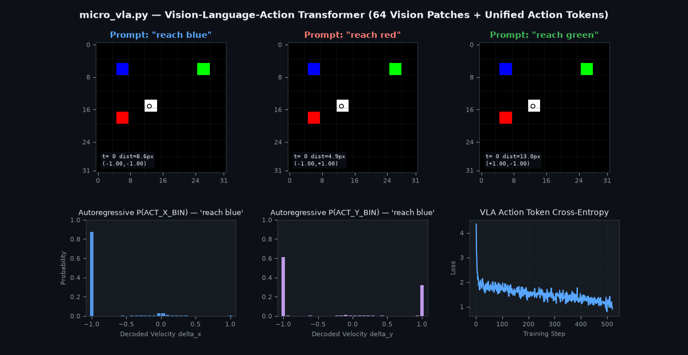

# microVLA

A single-file, first-principles PyTorch implementation of an **RT-2 style Vision-Language-Action (VLA)** model (`~360` lines of core VLA code), inspired by Andrej Karpathy's [`microgpt`](https://karpathy.github.io/2026/02/12/microgpt/).

`micro_vla.py` trains a causal Transformer from scratch on a synthetic 2D RGB robotic reaching environment and runs closed-loop autoregressive motor inference on a standard CPU in **~25 seconds** with no external dependencies beyond `torch` and `matplotlib` (for saving the demo GIF).



---

## Core Idea: Actions as Language Tokens

Following **RT-2 (Robotic Transformer 2)**, `micro_vla.py` casts continuous visuomotor control as standard next-token prediction over a single unified sequence:

1. **Vision Patches (`64` tokens)**: A `32x32x3` RGB camera observation is split into `8x8 = 64` non-overlapping `4x4` patches (`48` floats per patch), linearly projected to `d_model = 64`, and summed with learned 1D spatial positional embeddings (`MicroPatchEmbed`).
2. **Unified Token Vocabulary (`70` tokens)**:
   - **Text & Control Tokens (`0..5`)**: `["PAD", "ACT_START", "reach", "red", "green", "blue"]`
   - **Discretized Action Bin Tokens (`6..69`)**: Continuous 2D velocity commands $(\Delta x, \Delta y) \in [-1.0, 1.0]$ are uniformly quantized into `32` bins per axis (`X_BIN_0 .. X_BIN_31` and `Y_BIN_0 .. Y_BIN_31`) via `action_to_bin` and decoded back to continuous velocities via `bin_to_action`.
3. **Unified Causal Sequence (`68` tokens)**:
   ```text
   Input Sequence:  [PATCH_0 ... PATCH_63] | ["reach", <color>] | ["ACT_START"] | [ACT_X_BIN]
   Target Sequence: [   ... ignored ...  ] | [  ... ignored ... ] |  [ACT_X_BIN]  | [ACT_Y_BIN]
   ```
   A 3-layer, 4-head Pre-Norm Causal Decoder Transformer (`MicroVLA`, `117,248` parameters) processes the concatenated multimodal stream and is trained with standard cross-entropy loss (`ignore_index=-100` on vision and prompt positions) to autoregressively predict `ACT_X_BIN` followed by `ACT_Y_BIN`.

---

## Quickstart

### 1. Install Dependencies

Only `torch` and `matplotlib` (with `pillow` for GIF export) are required:

```bash
pip install torch matplotlib pillow
```

### 2. Run Training, Inference & Visualization

```bash
python micro_vla.py
```

In **~25 seconds on CPU**, the script:
1. Generates `7,500` synthetic expert image-text-action sequences on the fly using a proportional controller (`generate_vla_dataset`).
2. Trains `MicroVLA` for `520` steps with `AdamW` (`train_vla`).
3. Evaluates closed-loop autoregressive rollouts (`run_inference`) on an unseen environment configuration across all three instructions (`"reach blue"`, `"reach red"`, `"reach green"`).
4. Prints ASCII trajectory maps and token predictions to the terminal and saves `micro_vla_demo.gif`.

---

## Preventing Imitation Learning Causal Confusion

A classic pitfall when training language-conditioned policies on single-goal expert trajectories is **causal confusion**: for timesteps $t \ge 1$ along a trajectory, the robot gripper is already moving toward—and closest to—the prompted target dot. A model trained naively on single-prompt trajectories learns the shortcut *"move toward whichever colored dot is closest to the gripper"* and ignores the language instruction token `<color>` at $t = 0$.

To force true visual-language grounding:
- For every rendered visual frame along a trajectory in `generate_vla_dataset`, we supervise **all three counterfactual instructions** (`"reach red"`, `"reach green"`, `"reach blue"`) on the exact same image.
- During `train_vla`, mini-batches group all three counterfactual prompts for each sampled visual state, canceling out prompt-agnostic gradients and forcing attention heads on `"ACT_START"` to bind the `<color>` token to the matching visual patch coordinates.

---

## Sample Terminal Output

```text
Unified VLA Vocabulary Size: 70 tokens (6 text/control + 32 X-bins + 32 Y-bins)
Generating synthetic expert demonstrations (250 episodes x 10 steps x 3 prompts = 7,500 sequences)...
Initialized MicroVLA | Parameters: 117,248 | Sequence Length: 68 tokens

--- Training MicroVLA on CPU ---
step    1 /  520 | loss: 4.4279 | elapsed:  0.07s
step  130 /  520 | loss: 1.4015 | elapsed:  5.75s
step  260 /  520 | loss: 1.2988 | elapsed: 11.48s
step  390 /  520 | loss: 0.9127 | elapsed: 17.60s
step  520 /  520 | loss: 0.7377 | elapsed: 23.72s

=== Autoregressive Rollout: 'reach blue' ===
Start: (17.8, 13.2) -> Goal (BLUE): (25.9, 25.1) | Distance: 14.34px -> 2.07px (min: 1.46px)
+--------------------------------+
|................................|
|................................|
|................................|
|.....R..........................|
|................................|
|................................|
|..................0.............|
|....................1...........|
|................................|
|......G...............2.........|
|........................3.......|
|......................4.........|
|......................6.5.B.....|
|........................7@9.....|
|................................|
|................................|
+--------------------------------+
Legend: [R/G/B] Targets | [0..9] Gripper Path | [@] Final Gripper Position
  t= 1 | tokens=(X_BIN_31, Y_BIN_31) -> action=(+1.00, +1.00) | dist_to_goal=11.31px
  t= 2 | tokens=(X_BIN_31, Y_BIN_31) -> action=(+1.00, +1.00) | dist_to_goal= 8.32px
  t= 3 | tokens=(X_BIN_31, Y_BIN_31) -> action=(+1.00, +1.00) | dist_to_goal= 5.48px
  t= 4 | tokens=(X_BIN_0 , Y_BIN_31) -> action=(-1.00, +1.00) | dist_to_goal= 4.76px
  t= 5 | tokens=(X_BIN_31, Y_BIN_31) -> action=(+1.00, +1.00) | dist_to_goal= 1.68px
  t=14 | tokens=(X_BIN_15, Y_BIN_16) -> action=(-0.03, +0.03) | dist_to_goal= 1.98px
  t=15 | tokens=(X_BIN_15, Y_BIN_16) -> action=(-0.03, +0.03) | dist_to_goal= 2.07px
```

---

## Code Layout (`micro_vla.py`)

| Section | Lines | Description |
| :--- | :---: | :--- |
| **Phase 1: Action Tokenization** | `28–57` | Unified 70-token vocabulary (`VOCAB`), `action_to_bin`, and `bin_to_action` helpers |
| **Phase 2: Synthetic Environment & Data** | `60–162` | `32x32x3` RGB renderer (`render_env`), tabletop state sampler (`sample_env_state`), and counterfactual expert trajectory generator (`generate_vla_dataset`) |
| **Phase 3: MicroVLA Architecture** | `165–263` | `MicroPatchEmbed`, `CausalSelfAttention`, `TransformerBlock`, and `MicroVLA` causal decoder |
| **Phase 4: Training & Inference** | `266–378` | `train_vla` (`AdamW` loop) and closed-loop autoregressive `run_inference` |
| **Part II: Visualization & Demo Infra** | `380–541` | Terminal ASCII map printer (`print_ascii_rollout`) and Matplotlib animated GIF exporter (`save_demo_gif`) |
